  

# Axiom

This is the source for [axiomwtf.github.io](https://axiomwtf.github.io), the website for Axiom, my small independent software studio.

I currently have two tools:

- **Jiggle** (spec 0.2.1) is going to be deprecated in favor of Poly. It takes a single `.jgl` source file containing Rust, JavaScript, Python and other languages and compiles it into one native executable.
- **vfsx** (spec 0.2.0) packs a folder into one signed, content-addressed archive (Ed25519) that anyone can verify.

I'm also developing **Poly** (spec 0.2.1). It's a build system and package manager for Rust, C/C++ and Go, and it will replace Jiggle.

## What's in here

- `index.html` is my home page.
- `jiggle.html` covers Jiggle.
- `vfsx.html` covers vfsx.
- `poly.html` covers Poly.
- `polyspec.md` is the Poly spec.

Each page is a single HTML file with its CSS and favicon inlined, so I don't use a build step or a framework. The only thing loaded from outside is the fonts (Archivo and Spline Sans Mono) from Google Fonts. Pushing to `main` publishes the site through GitHub Pages.

The numbered grids use a fixed number of columns. If I add an item, I keep the total a multiple of the column count so the last row isn't left half empty.

## Running it locally

Open any page in a browser, or serve the folder:

    python3 -m http.server

## License

MPL-2.0.

## Contact

Everything is on GitHub: <https://github.com/axiomwtf>
